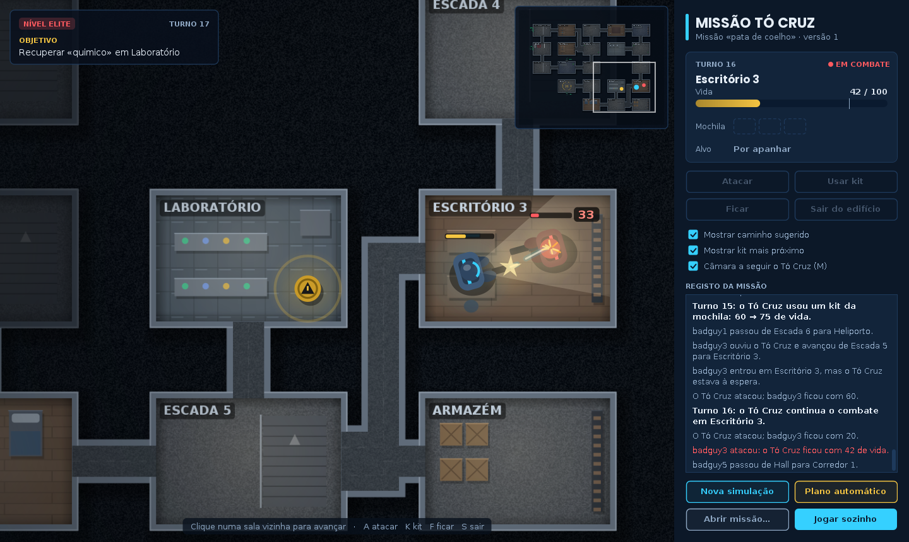
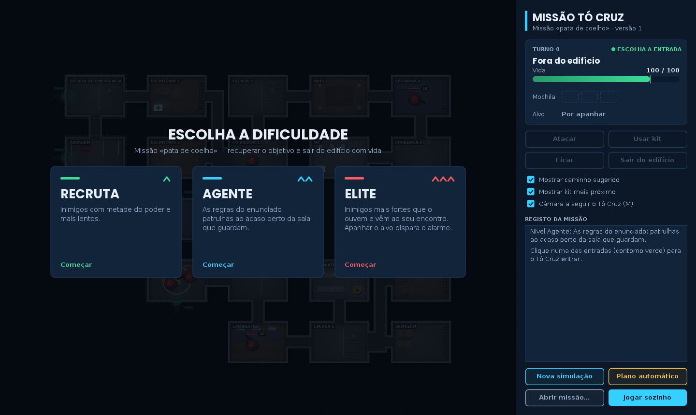

# Missão Tó Cruz – simulador de incursões

Simulador em Java onde o agente Tó Cruz entra num edifício controlado por criminosos, tem de chegar ao alvo (resgatar um refém, recuperar um objeto, desarmar uma arma) e sair com vida. O edifício é um grafo pesado e as decisões do modo automático são tomadas com o algoritmo de Dijkstra sobre esse grafo. Pode jogar-se na consola ou numa interface gráfica: uma planta tática vista de cima, com animações, três níveis de dificuldade e inimigos que perseguem o jogador.

Trabalho prático de grupo de **Estruturas de Dados** (2.º ano da Licenciatura em Engenharia Informática, ESTG – Politécnico do Porto, 2024/25), revisto em 2026.

[](https://github.com/fmpoliveira05-jpg/missao-to-cruz/actions/workflows/ci.yml)



## Equipa

| | |
|---|---|
| Artur Pinto | [@ArturESTG](https://github.com/ArturESTG) |
| Francisco Oliveira | [@fmpoliveira05-jpg](https://github.com/fmpoliveira05-jpg) |

O histórico de *commits* original foi mantido, por isso o contributo de cada um continua visível no separador *Commits*.

**O meu papel:** na entrega trabalhei sobretudo na lógica da simulação (movimento e ataque dos inimigos, combate e uso de kits pelo Tó Cruz), no modo automático e na documentação Javadoc. Na revisão de 2026 reorganizei o projeto em Gradle multi-módulo, revi a escolha de cada estrutura de dados e corrigi as que estavam mal aplicadas, separei as regras do jogo da consola num motor com testes e fiz a interface gráfica, com os níveis de dificuldade.

## O enunciado em poucas palavras

A IMF quer um simulador para o Tó Cruz treinar as missões antes de as fazer. Cada missão vem num ficheiro JSON com as divisões do edifício, as ligações entre elas, os inimigos (e o seu poder de ataque), as entradas/saídas, a posição do alvo e os itens espalhados pelo edifício (kits de vida e coletes).

Regras principais:

- o Tó Cruz começa com 100 pontos de vida e guarda até 3 kits numa **mochila** (usa sempre o do topo);
- os coletes somam pontos imediatamente, mesmo acima dos 100;
- ao entrar numa sala com inimigos o Tó Cruz ataca primeiro; os inimigos que sobrevivem respondem na fase deles;
- a cada turno os inimigos podem mover-se até duas divisões, sem se afastarem mais de duas divisões da sala que guardam;
- a missão só tem sucesso se o Tó Cruz passar pelo alvo e sair do edifício com vida.

O enunciado proibia a Java Collections Framework: todas as coleções usadas são as desenvolvidas pelo grupo nas aulas.

## Funcionalidades

- **Interface gráfica** – planta tática vista de cima, com as salas mobiladas conforme o tipo (laboratório, garagem, heliporto, camaratas...).
  - Os movimentos, os tiroteios, as quedas e as curas são animados. A câmara segue o Tó Cruz, com um minimapa do edifício.
  - Joga-se com o rato (clicar numa entrada para entrar e numa sala vizinha para avançar) ou com o teclado.
  - Mostra o caminho mais seguro até ao objetivo e até ao kit mais próximo, e o plano do modo automático. Também pode jogar sozinha.
- **Três níveis de dificuldade:**
  - **Recruta:** inimigos com metade do poder.
  - **Agente:** as regras do enunciado.
  - **Elite:** inimigos mais fortes que ouvem o Tó Cruz e vão ao encontro dele; salas fora de alcance às escuras; ao apanhar o objetivo dispara um alarme com os turnos contados para sair.
- **Objetivo obrigatório** – a missão só é cumprida se o Tó Cruz apanhar o objetivo e sair com ele. Sair sem o objetivo, morrer ou (no nível Elite) deixar acabar o tempo do alarme é missão falhada.
- **Importar missões** a partir de JSON, com validação completa do ficheiro (divisões inexistentes, campos em falta e valores inválidos são reportados com uma mensagem clara).
- **Modo manual** na consola – escolhe-se a entrada e, turno a turno, o que o Tó Cruz faz entre as opções possíveis (mover, atacar, usar kit, ficar, sair). Em cada turno é sugerido o melhor caminho até ao objetivo e até ao kit mais próximo.
- **Modo automático** – calcula, para todas as combinações de entrada e saída, o trajeto que termina com mais vida e diz se a missão é viável.
- **Jogo automático** – o Tó Cruz joga sozinho, com os inimigos a moverem-se, e recalcula o caminho em cada turno.
- **Resultados das simulações manuais** de cada missão, ordenados pela vida restante, e **exportação** dos trajetos para JSON.

## Estruturas de dados: onde e porquê

| Estrutura | Uso | Porquê esta |
|---|---|---|
| Grafo pesado dirigido (`Network`, matriz de adjacência) | o edifício | O peso de uma ligação é o dano que o Tó Cruz sofre ao **entrar** na divisão de destino, por isso depende do sentido. Com 20 a 30 divisões a matriz é pequena e dá o peso de qualquer ligação em O(1). |
| Fila de prioridade mínima (`PriorityQueue`, sobre `ArrayHeap`) | Dijkstra | Tira sempre a divisão ainda por fechar com menor distância acumulada. |
| Fila (`LinkedQueue`) | pesquisas em largura: zona de patrulha (até 2 ligações) e caminho de um inimigo até ao Tó Cruz (nível Elite); trajeto do Tó Cruz | A BFS visita por ordem de distância, por isso o primeiro caminho encontrado é o que tem menos ligações; o trajeto é lido pela ordem em que foi feito. |
| Lista em vetor (`ArrayUnordered`) | divisões candidatas de cada inimigo; caminhos | O movimento escolhe uma candidata ao acaso, o que precisa de acesso por índice. |
| Pilha (`LinkedStack`) | mochila | O enunciado manda usar sempre o último kit guardado. |
| Lista ordenada (`LinearLinkedOrderedList`) | missões por código/versão; simulações por vida restante | Mantém a ordem à medida que se insere. |
| Lista não ordenada ligada | inimigos de cada divisão, inimigos abatidos, relato do turno | Inserções e remoções frequentes, sem ordem. |

A biblioteca da unidade curricular tem ainda listas duplamente ligadas, árvores binárias de pesquisa (em vetor e ligadas) e *heaps*, também com testes. A `NetworkListaAdjacencia` ficou por completar: para edifícios muito grandes e com poucas ligações seria a representação certa.

## Estrutura do projeto

```
estruturas-dados/   biblioteca de coleções (pacotes ed.*)                          145 testes
jogo/               modelo, regras (tocruz.motor) e modos de jogo (tocruz.missoes)    80 testes
app/                menu de consola; missoes/ tem o ficheiro de exemplo
gui/                interface gráfica em Swing                                         4 testes
```

As regras estão todas em `tocruz.motor`, sem qualquer leitura ou escrita na consola:

- `MotorJogo` recebe as ações do jogador, aplica as fases do turno e regista cada acontecimento como `Evento` (que a interface anima);
- `Dificuldade` define os três níveis;
- `MovimentoInimigos` move os inimigos (patrulha ou perseguição);
- `PlaneadorMissao` calcula o plano do modo automático;
- `JogadorAutomatico` joga sozinho.

A consola (`Simulacoes`) e a interface gráfica (`JanelaMissao`) usam o mesmo motor.

## Como executar

Requisitos: **Java 17** ou superior. Não é preciso instalar o Gradle, o *wrapper* trata disso.

```bash
git clone https://github.com/fmpoliveira05-jpg/missao-to-cruz.git
cd missao-to-cruz
./gradlew build                      # compila e corre os 229 testes (no Windows: gradlew.bat build)
./gradlew :gui:run                   # interface gráfica (abre a missão de exemplo)
./gradlew :app:run --console=plain   # versão de consola
```

Também é possível gerar `.jar` executáveis:

```bash
./gradlew :gui:jar :app:jar
java -jar gui/build/libs/missao-to-cruz-gui.jar [missao.json]
cd app && java -jar build/libs/missao-to-cruz.jar
```

### Primeira partida (interface gráfica)



1. Escolher o nível: **Recruta**, **Agente** ou **Elite**.
2. As entradas piscam a verde: clicar numa para o Tó Cruz entrar.
3. Clicar numa sala vizinha para avançar.
   - As salas para onde se pode ir têm contorno tracejado.
   - A azul aparece o caminho que custa menos vida até ao objetivo; a verde tracejado, o caminho até ao kit mais próximo.
   - Passar o rato por cima de uma sala mostra os inimigos e o dano previsto.
4. Numa sala com inimigos só se pode **Atacar** (tecla A) ou **Usar kit** (K). Ao encontrar um kit escolhe-se usar, guardar ou deixar (1, 2, 3). **F** fica onde está e **M** liga ou desliga a câmara que segue o Tó Cruz.
5. Com o objetivo apanhado, voltar a uma entrada e carregar em **Sair do edifício** (S). No nível Elite o alarme conta os turnos que faltam.
6. **Plano automático** desenha o plano do modo automático; **Jogar sozinho** põe o Tó Cruz a jogar turno a turno.

## O que mudou na revisão de 2026

### Organização

- Os três projetos IntelliJ independentes, que dependiam uns dos outros através de `.jar` copiados à mão, passaram a ser um único *build* Gradle multi-módulo.
- Os pacotes passaram a seguir as convenções Java (`ed.linkedlist` em vez de `LinkedList`, por exemplo).
- O histórico foi limpo de ficheiros gerados (`build/`, `.gradle/`, `.idea/`, `.jar`): o repositório passou de ~80 MB para ~5 MB, com todos os *commits* e autores.

### Estruturas de dados e regras

- **Dijkstra.** A *heap* ordenava as divisões pela ordem em que foram criadas e não pela distância acumulada, por isso o "caminho mais curto" dependia da ordem das divisões no ficheiro. Passou a usar uma fila de prioridade ordenada pela distância. Há um teste com um grafo em que a versão antiga escolhe o caminho errado.
- **Pesos do grafo.** O custo de uma divisão era escrito nos dois sentidos de cada ligação, e atualizar uma divisão apagava o custo da vizinha. Agora o custo só se aplica a quem entra, e o resultado deixou de depender da ordem das atualizações.
- **Custo de entrada.** Passou a ser o dano real do combate (o Tó Cruz ataca primeiro e os inimigos que sobrevivem respondem até a sala ficar limpa). Com isso, a vida prevista pelo modo automático bate certo com a de um jogo em que os inimigos não se mexem, e o regresso já não volta a contar os inimigos eliminados na ida.
- **Movimento dos inimigos.** Os inimigos andavam pelo edifício sem limite; agora nunca se afastam mais de duas ligações da sala que guardam (pesquisa em largura limitada). A escolha ao acaso usava uma pilha e passou a usar uma lista com acesso por índice.
- **Cópia do edifício.** Cada simulação começa numa cópia do edifício, mas a cópia ligava todas as divisões entre si. Passou a recriar só as ligações que existem.
- **Iterador do grafo.** Era uma pesquisa em profundidade a partir da primeira divisão: deixava de fora divisões ainda sem ligações. Passou a percorrer todos os vértices.
- **Pequenos erros.**
  - `Divisao.equals` comparava nomes com `==`.
  - Usar um kit com mais de 100 de vida (graças a um colete) fazia perder o kit.
  - Uma condição do movimento dos inimigos nunca era verdadeira.

### Código e interface

- **Motor separado da consola.** A classe `Simulacoes` tinha 1200 linhas com regras e perguntas ao jogador misturadas, sem testes possíveis. As regras passaram para `tocruz.motor`, com 23 testes novos, e a consola e a interface gráfica usam o mesmo motor.
- **Interface gráfica nova.**
  - A posição de cada sala numa grelha é escolhida por *simulated annealing*, para as ligações ficarem curtas, sem se cruzarem e sem passarem por cima de outras salas.
  - Cada ligação vira um corredor reto, em "Z" ou em "L".
  - Tudo é desenhado em código com Java2D, sem imagens de terceiros.
  - As animações são geradas a partir dos eventos do motor, por isso mostram exatamente o que as regras decidiram.
- **Níveis de dificuldade.**
  - O nível Agente é o do enunciado (e o da consola).
  - No nível Elite, a perseguição usa uma pesquisa em largura pelo caminho com menos ligações. O inimigo avança uma sala por turno e, sem alarme, não se afasta mais de três ligações da sua sala.
  - Quem chega à sala do Tó Cruz cai numa emboscada. O alarme dá os turnos do caminho mais curto até à saída, mais três.
- **Importação.** Passou a **validar** o ficheiro. Antes, uma divisão mal escrita causava um `NullPointerException` e um ficheiro inexistente dava uma missão `null`.
- **Exportação e menu.** A exportação repetia versões e contava mal as simulações. O menu ganhou as opções "ver mapa" e "ver resultados" pedidas no enunciado.
